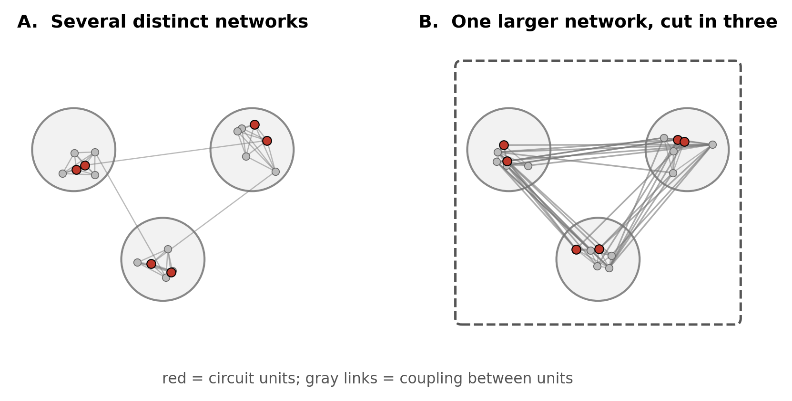
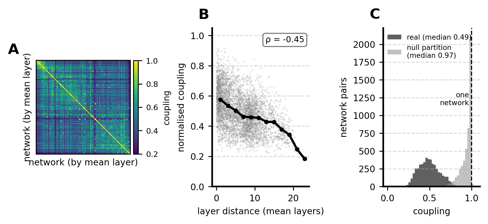
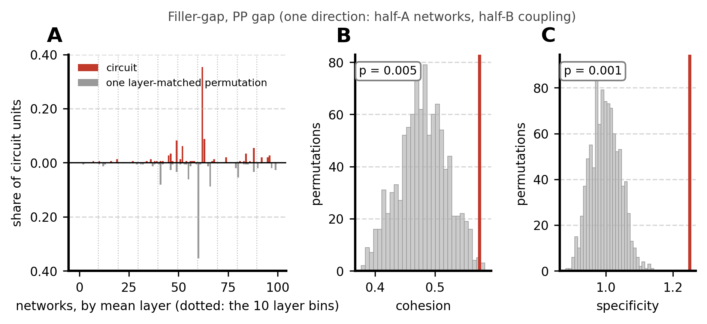
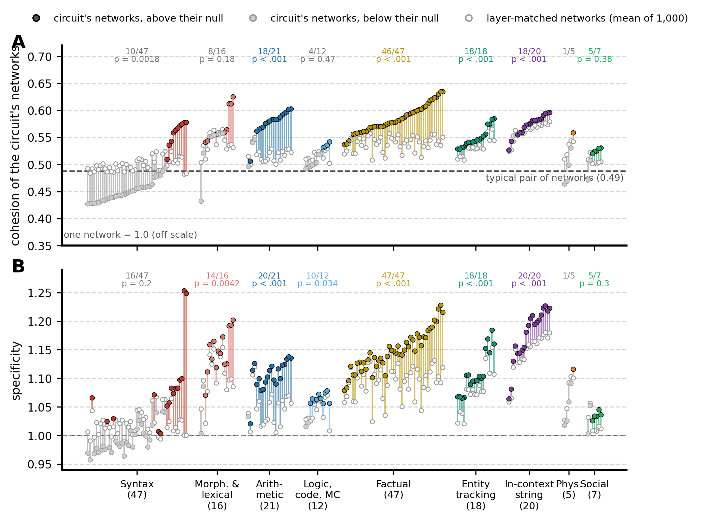
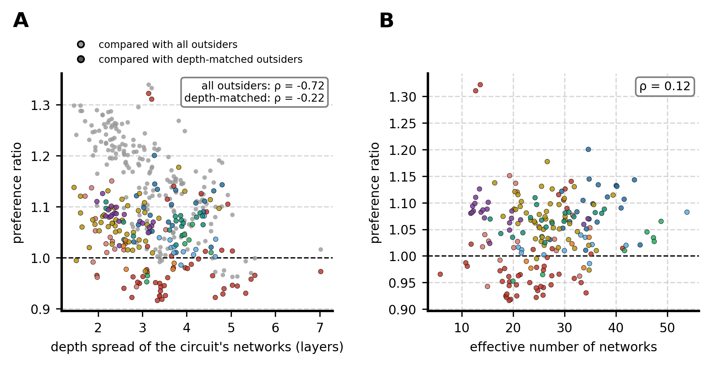

# Are the networks a circuit spans one larger network?

This page reports LOG.md Iteration 46 for Qwen3.5-2B (4B pending). It follows the per-task concentration result ([../circuits_vs_networks/](../circuits_vs_networks/), Iteration 44): circuits found by attribution patching fall into far fewer networks than random sets of neurons do. A typical circuit still spans many networks, about 25 at the median and 10-15 for the most concentrated tasks. This page asks what those networks are to each other.

## In short

**Not one network.** The networks a circuit spans are distinct networks, not pieces of a single larger network that fitting 100 networks has cut apart. They couple to each other at about half the strength found within one network (median 0.56 on a scale where one network is 1), and no task comes close to 1.

**More interlinked than other networks, in most domains.** The networks a circuit spans are more coupled to each other than a typical pair of networks (153 of 193 tasks). They are also more coupled than networks at the same depth in the model (128 of 193 tasks; Wilcoxon signed-rank across tasks, p = 1.5 × 10⁻⁵).
- The effect is strongest and most consistent for factual knowledge (46 of 47 tasks), arithmetic (18 of 21), entity tracking and binding (18 of 18) and in-context string tasks (18 of 20).
- These sets of networks are also *specific*: their networks are coupled to each other more than to networks in general.

**Syntax is the exception.** Most syntax circuits (37 of 47) span networks that are *less* coupled to each other than networks at the same depth, and less than a typical pair of networks. The exceptions within syntax are filler-gap dependencies and NPI licensing, which are among the most cohesive tasks of any domain.

**A correction to the first version of this page.** The first version counted a task as cohesive only when its own permutation test gave p < 0.05 in both directions (53 of 193). It concluded that most circuits use networks "no more coupled than chance". That was wrong. A single task's test has little power: the spread of its null (SD 0.024 in cohesion) is larger than the typical effect (+0.014). Most tasks with a real effect therefore fail to reach significance on their own. Treating "not significant" as "no effect" contradicted what Figure 4 shows, where most tasks sit above their null. The evidence is the consistency of the effect across tasks, and that is what is tested now (section 3.5).

## 1. The question

A circuit is the top 0.1% of a task's neurons by attribution (147 of the model's 147,456 MLP neurons). Each neuron belongs to one of 100 networks fitted on task-free text, so a circuit has a share in each network. Its effective number of networks summarises how spread those shares are. Circuits span far fewer networks than random neuron sets, but a language circuit still spans about 10 to 25 networks. Two readings of that number are possible (Figure 1).

**Figure 1.** Two ways a circuit (red neurons) can span three networks (circles). **A.** The networks are distinct: neurons are coupled within a network and only weakly across networks. The task recruits several separate systems together. **B.** The three networks are strongly coupled to each other and behave as one larger network (dashed box). Fitting 100 networks has cut a single system into three pieces, and "three networks" is an artefact of granularity.

The two readings make different predictions about one quantity: **how strongly the circuit's networks are coupled to each other**. Under B they are coupled almost as strongly as neurons within one network. Under A they are coupled like ordinary pairs of networks. Between the two extremes, a circuit can use networks that are distinct but more interlinked than usual: a loosely coupled group rather than one network.

## 2. Data

- **Model and neurons.** Qwen3.5-2B, all 24 × 6,144 = 147,456 MLP neurons (post-nonlinearity).
- **Networks.** The 100 networks of the pooled residual connectome (Iteration 43), the same networks used in the concentration result:
  - text from four prose datasets (wikitext, bookcorpus, agnews, tldr17);
  - each activation minus a token-type and position fit;
  - two halves of independent text (half A, half B), each with its own partition.
- **Connectome.** The stored connectome of the rich-club stage (Iteration 45), which recomputed the same tiles and keeps them. Before use, the 36 stored network scores were recomputed on these tiles. They agree to within 3.9 × 10⁻¹⁰, so the connectome is identical to the one the networks were fitted on.
- **Tasks and circuits.** The 193 tasks that passed the inclusion rule at 2B (164 from the task bank, 29 from LLM_Modularity). The circuits are those of the concentration analysis: same attribution, same top-0.1% rule.

## 3. Method

### 3.1 Coupling between two networks

The raw coupling between networks i and j, $B_{ij}$, is the mean |r| over all pairs of a neuron in i and a neuron in j. Within a network (i = j), it is the mean over its distinct pairs.

**In words:** pick a neuron in network i and a neuron in network j at random; $B_{ij}$ is how strongly they correlate on average, ignoring the sign. $B_{ii}$ is the same for two neurons of the same network.

*Why |r|.* The networks were fitted on |r|, and a strong negative correlation is as strong a coupling as a positive one (the project's convention since 2026-10-20).

Raw coupling is small and differs between networks: median within-network coupling is 0.032, between-network 0.015. Some networks are tight and some loose, so a raw value of, say, 0.02 means something different for different pairs. To give "as tight as one network" a fixed value, coupling is normalised:

$$\tilde B_{ij} = \frac{B_{ij}}{\sqrt{B_{ii}\,B_{jj}}}.$$

**In words:** the coupling between two networks, expressed as a fraction of how tightly each is coupled internally. The square root of the product is the geometric mean of the two within-network couplings, so neither network's tightness counts more.
- 1: the two networks are as coupled to each other as each is internally. They are effectively one network (reading B).
- 0.5: neurons in different networks correlate half as strongly as neurons in the same network.

Networks also differ in size (29 to 5,786 neurons, median 1,190). Each coupling is already a mean over pairs of neurons, so large networks do not count more.

*Why the other half.* The partition fitted on half A is evaluated on the connectome of half B, and the partition fitted on half B on the connectome of half A. A partition groups together neurons that happen to correlate in the half it was fitted on. Measured on that same half, its within-network coupling is inflated by fitting noise; measured on the other half, it is an honest estimate. The inflation turned out small (median within-network coupling 0.0334 on the fitting half, 0.0324 on the other), but the cross-half estimate is correct by construction. The two directions also replicate each other.

**Figure 2.** Coupling between the 100 networks (half-A networks on half-B connectome). **A.** Normalised coupling, networks ordered by their mean layer. **B.** Coupling falls with the distance in depth between two networks (each gray dot is a pair; black: mean per 2-layer bin). Networks within 2 layers of each other couple at 0.58 on average; networks more than 6 layers apart at 0.45. **C.** Distribution over all pairs. On the real networks a typical pair couples at 0.49 of within-network strength: the networks are distinct. On the null partition (the same pipeline run on circularly shifted timecourses, which keep each neuron's statistics but destroy co-activation) pairs couple at 0.97: those "networks" are interchangeable, as expected.

### 3.2 How cohesive are a circuit's networks?

Let $p_i$ be the share of the circuit's neurons in network i (the shares sum to 1). The circuit's **cohesion** is

$$C = \frac{\sum_{i \neq j} p_i\, p_j\, \tilde B_{ij}}{\sum_{i \neq j} p_i\, p_j}.$$

**In words:** pick two of the circuit's neurons that sit in different networks, and look up the normalised coupling between their two networks. C is the average of that coupling over all such pairs of neurons.
- A pair of networks gets weight $p_i p_j$, in proportion to how many such pairs of neurons it contains.
- The denominator turns the weighted sum into a weighted average.
- Pairs within the same network are excluded (i ≠ j). C is about how the networks relate to each other, not how tight each one is.

C is on the same scale as $\tilde B$: 1 means the circuit's networks behave as one network.

*Why weight by shares (Andrea, 2026-10-21).* Take a circuit with 40% of its neurons in one network and one neuron in each of five others. It is mostly about the first network. With share weights, a network counts in proportion to how much of the circuit it holds, so a single stray neuron cannot dominate. The alternative was to count every touched network equally.

### 3.3 The reference: the same profile, given to other networks

The question is whether these particular networks are more of one thing than other networks would be. The reference therefore keeps the circuit's share profile exactly (the same number of networks, with the same shares) and hands it to other networks. How concentrated the circuit is stays fixed; only which networks it sits on changes.

**In words:** take the circuit's bar chart of shares over networks (Figure 3A, top) and move each bar to a different network at a similar depth (Figure 3A, bottom). Recompute C. Do this 1,000 times. The mean of these 1,000 values is the **layer-matched reference**, $C_{\text{null}}$.

*Why not random neurons (Andrea, 2026-10-20).* The concentration test compared circuits with random neuron sets. Reused here, that would ask whether the circuit's neurons pick more coupled networks than random neurons happen to land in. A random neuron set spreads over many more networks than the circuit does, so the comparison would mix the circuit's spread with the identity of its networks. Moving the circuit's own profile isolates identity.

*Why match on depth (Andrea, 2026-10-21).* Networks are layer-local, and coupling depends strongly on depth (Figure 2B; Spearman ρ = -0.45 between layer distance and coupling). Circuits favour particular layers. An unconstrained reference would hand the circuit's profile to networks spread across all depths, which couple less for that reason alone, so any circuit concentrated in a few layers would look cohesive. Each network's depth is the mean layer of its neurons. The 100 networks are sorted by depth and cut into 10 bins of 10 networks, and a network is only ever replaced by another network of its own bin.

**Figure 3.** The test for one task (filler-gap, PP gap; half-A networks, half-B coupling). **A.** Above the axis, the circuit's share in each network (networks ordered by depth; dotted lines separate the 10 depth bins). Below, the same profile after one layer-matched permutation: the bars move to other networks of the same bins. **B.** Cohesion of the 1,000 permutations (gray) and of the circuit (red). **C.** The same for specificity (section 3.4).

*A limit of this reference.* A bin holds 10 networks. If a circuit covers most networks of a bin, permutations can only reshuffle its shares among those same networks, and the reference comes close to the circuit itself. This makes the comparison conservative for circuits packed into a few layers.

### 3.4 Specificity: a set of hubs is not one network

Some networks are coupled fairly strongly to every other network (the rich-club stage found strongly coupled hubs). A circuit that uses several such hub networks would have high cohesion without its networks forming a group of their own: they would be just as coupled to everything else. **Specificity** separates the two cases:

$$S = \frac{C}{\sum_i p_i E_i}, \qquad E_i = \frac{1}{k-1}\sum_{j \neq i} \tilde B_{ij}.$$

**In words:** $E_i$ is how strongly network i couples to the average other network, its general sociability. The denominator is the sociability of the circuit's networks, weighted by the circuit's shares: the cohesion one would expect if these networks coupled to each other no more than to anyone else. S is the ratio of the cohesion they actually show to that expectation.
- S > 1: the circuit's networks are coupled to each other more than to networks in general, so they form a group.
- S ≈ 1: they are simply well-connected networks.

*Why this control (Andrea, 2026-10-21).* The alternative was to match replacement networks on their sociability as well as on depth. The ratio is simpler and reads directly. Specificity is compared with the same layer-matched reference as cohesion. It must be read against that reference, not against 1: networks at similar depths couple more to each other than to networks in general (Figure 2B), so any depth-matched set has S above 1 (median 1.065 for the reference).

### 3.5 Statistics: per task and across tasks

**Per task.** For each task and direction, the one-sided permutation p is the share of the 1,000 permutations whose cohesion is at least the circuit's, counting the circuit itself: p = (1 + #{permuted C ≥ observed C}) / 1,001. This test is valid; on random circuits with no structure it gives p < 0.05 in 4.0% of cases (section 3.6). But it has little power. The spread of a task's reference (SD 0.024 in cohesion, median over tasks) is larger than the typical effect (+0.014), so the median task's effect is only 0.6 SD of its own null. Most tasks with a real effect cannot reach p < 0.05 on their own. **A non-significant task is not evidence that its networks are no more cohesive than the reference.** Per-task p-values are therefore not used to classify tasks.

**Across tasks.** The question for a domain is whether its circuits are *consistently* above their references. For each task, d = C − C_null (the mean of the two directions). Within a domain, d is tested against 0 with a two-sided Wilcoxon signed-rank test over tasks, and the count of tasks with d > 0 is reported. The same is done for specificity. Tasks of one domain partly share materials (several come from the same source), so they are not fully independent. The across-task p-values are best read as a summary of consistency rather than an exact error rate.

### 3.6 Verification

[tests/verify_iter46_cohesion.py](../../tests/verify_iter46_cohesion.py), 11 checks, all passing:

- cohesion and specificity equal brute-force double loops;
- within-bin permutations keep every network in its bin;
- the coupling matrices computed from tiled float16 halves equal dense block means of |r|;
- with no planted structure, p < 0.05 in 4.0% of 300 random circuits (the nominal 5%);
- a planted super-network (six networks coupled at 0.7 against a background of 0.2) is detected: p = 0.009, specificity 2.67;
- six hub networks coupled to everyone also beat the layer-matched reference on cohesion (p = 0.002), but their specificity is 1.00. Cohesion alone cannot separate a super-network from a set of hubs; specificity can.

### 3.7 Null partition

The whole analysis is repeated on the null partition (networks fitted on circularly shifted timecourses). There, coupling between networks is close to 1 everywhere (Figure 2C), so cohesion should carry almost no structure. This checks that the procedure does not manufacture an effect.

## 4. Results

The two directions (half-A networks on half-B coupling, and the reverse) agree almost perfectly: r = 0.989 between the two cohesion values across tasks. Values below are means over the two directions.

### 4.1 The circuit's networks are distinct networks

Cohesion has a median of 0.56 across the 193 tasks. The 10th to 90th percentiles span 0.45 to 0.60, and the maximum is 0.64. One network would score 1.0. Every circuit's networks are coupled to each other at roughly half of within-network strength, so none behaves like a single network. Reading B of Figure 1 holds for no task: the effective number of networks counts networks that are genuinely distinct.

### 4.2 More interlinked than other networks, except in syntax

**Figure 4.** Every task, grouped by domain and sorted by cohesion. **A.** Cohesion of the circuit's networks (filled) and of the layer-matched reference (open, mean of 1,000 permutations). A task is coloured when its circuit is above its reference, gray when below. Above each domain: the number of tasks above the reference, and the two-sided Wilcoxon signed-rank p across the domain's tasks (not computed for physical reasoning, 5 tasks). Dashed: a typical pair of networks (0.49). **B.** Specificity, same layout. Dashed: 1.

Over all 193 tasks:

- 153 circuits span networks more coupled than a typical pair of networks;
- 128 span networks more coupled than the layer-matched reference (median d = +0.014; Wilcoxon p = 1.5 × 10⁻⁵);
- 151 have specificity above their reference (median +0.026; p = 2.3 × 10⁻¹⁵).

| Domain | Tasks | Cohesion: circuit | Cohesion: reference | Above reference | Wilcoxon p | Specificity above reference |
|---|---|---|---|---|---|---|
| Factual knowledge | 47 | 0.58 | 0.54 | **46** | < 0.001 | 47 |
| Arithmetic | 21 | 0.58 | 0.52 | **18** | < 0.001 | 20 |
| Entity tracking & binding | 18 | 0.54 | 0.53 | **18** | < 0.001 | 18 |
| In-context string tasks | 20 | 0.58 | 0.57 | **18** | < 0.001 | 20 |
| Social reasoning | 7 | 0.53 | 0.51 | 5 | 0.38 | 5 |
| Morphology & lexical semantics | 16 | 0.56 | 0.54 | 8 | 0.18 | 14 |
| Logic, code & multiple choice | 12 | 0.51 | 0.52 | 4 | 0.47 | 10 |
| Physical reasoning | 5 | 0.50 | 0.54 | 1 | – | 1 |
| Syntax | 47 | 0.46 | 0.50 | **10** | 0.002 (below) | 16 |

Medians per domain. "Above reference" counts tasks with C > C_null; the p tests whether the domain's differences are centred on 0.

**Four domains are consistently above their reference.** For factual knowledge, arithmetic, entity tracking and binding, and in-context string tasks, nearly every circuit spans networks that are more coupled to each other than networks at the same depth. Nearly all of them are also more specific: their networks are coupled to each other more than to networks in general, so these are not merely sociable hub networks. The size of the effect differs. It is largest for arithmetic (median +0.064) and factual knowledge (+0.042), and small for entity tracking (+0.016) and string tasks (+0.010), where the reference is already high because those circuits sit in tightly coupled layers.

**Syntax is consistently below its reference.**
- 37 of 47 syntax circuits span networks less coupled to each other than layer-matched networks (median −0.045), and 36 fall below even a typical pair of networks.
- The agreement tasks drive this: subject-verb, determiner-noun and reflexive agreement, in every source that has them (CausalGym, CLAMS, Newman et al., Marks et al., EAP-IG, LLM_Modularity).
- These circuits recruit several networks that are, if anything, more separate than usual.

**Within syntax, long-distance licensing is the exception.** Filler-gap dependencies (+0.095 above the reference) and NPI licensing (+0.055 to +0.065, in both CausalGym and LLM_Modularity) are among the most cohesive tasks of any domain. Hypernymy plays the same role among the lexical tasks (+0.075 to +0.094, three versions from two sources).

**The remaining domains are mixed** (morphology and lexical semantics, logic and code, social and physical reasoning): their tasks fall on both sides of the reference, with no consistent direction.

### 4.3 Controls

**Figure 5.** **A.** Cohesion minus its layer-matched reference for every task, on the real networks (coloured) and on the null partition (gray); bars are medians. **B.** Cohesion against the effective number of networks (the concentration measure), one dot per task, coloured by domain.

**The null partition.** On the null partition, coupling between networks is close to 1 everywhere (Figure 2C) and barely varies. Cohesion there exceeds its reference by tiny but consistent amounts: median +0.005, and 151 of 193 tasks above. The effects on the real networks are larger in the domains that matter (median d, real against null partition): factual knowledge +0.042 against +0.000, arithmetic +0.064 against +0.014, entity tracking +0.016 against +0.002. Across all tasks, d is larger on the real networks in 119 of 193 (Wilcoxon p = 0.007). The null partition's small positive offset sets a floor: differences of a few thousandths should not be read as cohesion.

**Concentration and cohesion are unrelated.** Spearman ρ = −0.01 between a task's effective number of networks and the cohesion of those networks (Figure 5B). Agreement circuits combine high concentration with low cohesion, and factual circuits combine moderate concentration with high cohesion.

## 5. What this shows, and what it does not

**It shows that:**

- the effective number of networks counts distinct networks: the networks a circuit spans couple to each other at about half the within-network level, and never close to 1;
- in factual knowledge, arithmetic, entity tracking and binding, and in-context string tasks, circuits consistently use sets of networks that are more interlinked, and more specifically interlinked, than networks at the same depth: distinct networks that form a loosely coupled group;
- agreement circuits use networks that are less interlinked than networks at the same depth, while filler-gap, NPI licensing and hypernymy circuits use some of the most interlinked sets of any task.

**It does not show that:**

- **any set of networks forms a single system.** Even the most cohesive circuits (0.64) are far from 1.
- **the effects are large.** Domain differences in cohesion are a few hundredths on a 0-1 scale. They are consistent across tasks and across the two halves, and far above the null partition's offset, but modest.
- **which individual tasks are cohesive.** The per-task test is too weak to classify tasks one by one (section 3.5). Statements about single tasks, such as the filler-gap tasks, rest on their effect sizes and on agreement between related tasks, not on per-task significance.
- **anything about another granularity.** The analysis uses the 100-network partition. It asks whether its networks behave as one; it does not refit coarser partitions. A granularity curve (merging networks by their coupling and recomputing concentration at each level) was discussed as a complement but not run.
- **the same at 4B.** The 4B coupling job is ready to run once the 4B rich-club scoring finishes.

## 6. Files

| What | Where |
|---|---|
| Method (cohesion, specificity, reference) | [parcelmate/cohesion.py](../../parcelmate/cohesion.py) |
| Coupling matrices on the stored tiles (cluster) | [parcelmate/bin/network_coupling.py](../../parcelmate/bin/network_coupling.py), [scripts/launch_coupling.sh](../../scripts/launch_coupling.sh) |
| Per-task test (local) | [parcelmate/bin/circuit_cohesion.py](../../parcelmate/bin/circuit_cohesion.py) |
| Results, one row per task × tree × direction | [figures/circuit_cohesion_2b.csv](../../figures/circuit_cohesion_2b.csv) |
| Figures on this page | [figures/make_cohesion_figures.py](../../figures/make_cohesion_figures.py) |
| Verification | [tests/verify_iter46_cohesion.py](../../tests/verify_iter46_cohesion.py) |
| Coupling matrices | `results/richclub/qwen3.5-2b-resid-pool4-tiles{,_null}/metrics/coupling/coupling.npz` |
| Record of decisions | [info/LOG.md](../../info/LOG.md), Iteration 46 |
