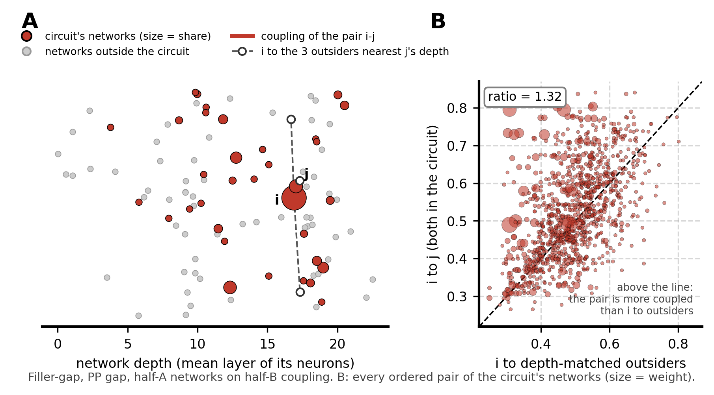

# Do the networks a circuit spans prefer each other?

LOG.md Iteration 46, Qwen3.5-2B (4B pending). A control for the concentration result ([../circuits_vs_networks/](../circuits_vs_networks/)). A circuit spans about 10-25 of the 100 networks. Are those networks pieces of one larger network, or distinct networks that the task uses together?

## Answer

- **Distinct networks.** A circuit's networks couple to each other at about half the strength found within one network (median 0.56 on a scale where 1 = one network). None comes close to 1.
- **In most domains, they prefer each other.** They are coupled to each other more than to comparable networks outside the circuit: 147 of 193 tasks, median +5%. This is consistent for arithmetic, in-context string tasks, entity tracking and factual knowledge (+7 to +10%).
- **Syntax is the exception.** Agreement circuits span networks that are less coupled to each other than to outsiders. Filler-gap and NPI licensing go the other way.

## The measure

Coupling between two networks is the mean |r| between their neurons, divided by how tightly each network is coupled inside, so 1 = as tight as one network. It is measured on the half of the data the networks were not fitted on.

**Preference ratio** = coupling among the circuit's networks ÷ coupling of the same networks to networks outside the circuit at the same depth.

For every pair of the circuit's networks (i, j), the coupling of i to j is compared with the coupling of i to the 3 outside networks closest in depth to j. Depth is a network's mean layer. Pairs are weighted by the circuit's share in each network, and the ratio is taken over the weighted sums. A ratio of 1 means no preference; 1.10 means 10% more coupled to each other than to comparable outsiders.

**Figure 1.** One task (filler-gap, PP gap). **A.** Networks by depth (vertical position is jitter); the circuit's networks are red, sized by share. The comparison for one pair i-j is i's coupling to the 3 outsiders nearest j's depth. **B.** Every pair of the circuit's networks: its coupling (y) against its comparison (x). Above the diagonal, the pair is more coupled than its comparison. Ratio = 1.32.

**Why outsiders at the same depth.** Networks close in depth couple more. A circuit packed into a few layers would otherwise look like a group just because its networks are neighbours. Compared with all outsiders, the ratio tracks how spread in depth a circuit is (ρ = −0.72). Compared with outsiders at the same depth, much less (ρ = −0.22). The matched outsiders sit a median 0.38 layers from the network they replace.

**Statistics.** For each task, the ratio is averaged over the two halves (they agree, r = 0.91). Per domain: the number of tasks above 1, and a Wilcoxon signed-rank test of the ratios against 1.

## Results

**Figure 2.** Preference ratio of every task, by domain. Filled: coloured above 1, gray below. Open: the same circuit on the null partition (networks fitted on shifted timecourses, no co-activation). Above each domain: tasks above 1, and the Wilcoxon p.

| Domain | Tasks | Median ratio | Above 1 | p |
|---|---|---|---|---|
| Arithmetic | 21 | 1.10 | 21 | < .001 |
| In-context string tasks | 20 | 1.08 | 20 | < .001 |
| Entity tracking & binding | 18 | 1.07 | 18 | < .001 |
| Factual knowledge | 47 | 1.07 | 45 | < .001 |
| Morphology & lexical | 16 | 1.03 | 13 | .013 |
| Logic, code & MC | 12 | 1.02 | 11 | .005 |
| Social reasoning | 7 | 1.03 | 5 | .47 |
| Physical reasoning | 5 | 0.99 | 2 | – |
| Syntax | 47 | 0.96 | 12 | .015 (below) |

- **Four domains are consistently above 1.** Their circuits use distinct networks that form a loose group.
- **Syntax is below 1.** This comes from agreement tasks (subject-verb, determiner-noun, reflexive) in every source. The exceptions are filler-gap (1.31-1.32) and NPI licensing (1.09-1.14).
- **The null partition stays close to 1** (median 1.01). The real networks are higher in 136 of 193 tasks (p = 1.4 × 10⁻¹⁰).
- **Preference is unrelated to how many networks a circuit spans** (ρ = 0.12).

**Caveats.** The effects are modest (a few to ten percent). Depth matching is approximate; the null partition's offset of 0.01 above 1 shows what remains of depth. Tasks from one source share materials, so the p-values summarise consistency rather than give exact error rates.

Code: [parcelmate/cohesion.py](../../parcelmate/cohesion.py), [parcelmate/bin/circuit_cohesion.py](../../parcelmate/bin/circuit_cohesion.py), [parcelmate/bin/network_coupling.py](../../parcelmate/bin/network_coupling.py). Values: [figures/circuit_cohesion_2b.csv](../../figures/circuit_cohesion_2b.csv). Figures: [figures/make_cohesion_figures.py](../../figures/make_cohesion_figures.py). Tests: [tests/verify_iter46_cohesion.py](../../tests/verify_iter46_cohesion.py) (12 checks). Earlier versions of this analysis and why they were replaced: [info/LOG.md](../../info/LOG.md), Iteration 46.
