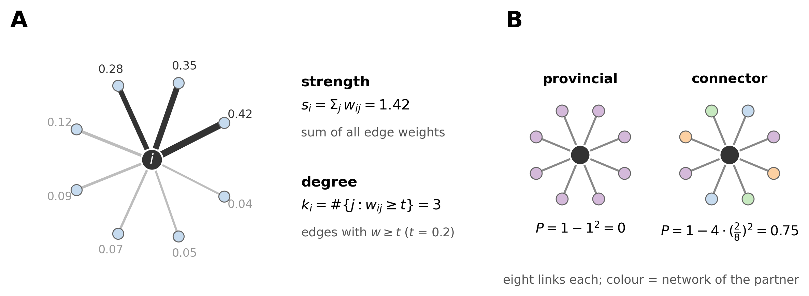

# Rich club in the functional connectome of language models

This page reports the first stage of the network-neuroscience analyses (LOG.md Iteration 45; plan in [info/RICH_CLUB_PLAN.md](../../info/RICH_CLUB_PLAN.md)). It asks whether the most strongly coupled MLP neurons of a language model are coupled mainly to each other. Pythia-70m is the pilot; Qwen3.5-2B and Qwen3.5-4B are the main models.

## In short

All three models have a rich club: their most strongly coupled neurons are more coupled to each other than their overall coupling predicts. This replicates across two independent halves of the data. It also survives a null in which every neuron keeps its own statistics but co-activation is destroyed. That null has a sizeable club of its own, so the real excess over it is what counts. The excess is large in Pythia-70m, modest in Qwen3.5-2B (1-12%, depending on the club's size) and somewhat larger in Qwen3.5-4B (1-17%).

The models build their club differently. In Pythia-70m the extra coupling is between hubs in the same layer: across layers, the real hubs couple no more than the null's. In both Qwen models the club also holds across layers, and it spreads over most of the networks.

In all three models the hubs are provincial. Each unit's closest partners lie disproportionately in its own network, beyond what layer-locality or the null produce. Hubs show this more than weaker units, and real hubs more than the null's. So the club is made of units that each anchor their own network and are also coupled to each other: in the Qwen models, anchors of many different networks. This resembles the human functional rich club, whose members connect mainly within their own systems.

## 1. The question

Picture the network formed by a model's MLP neurons. Each neuron is a node, and two neurons are linked by how strongly their activations correlate over text. Some neurons are linked strongly to many others. We call these neurons **hubs**. A system with hubs can be organised in two broad ways, shown in Figure 1.

**Figure 1.** Two networks with the same hubs (black). **A.** Each hub anchors its own group of neurons, and the hubs barely link to each other. Communication between groups goes through ordinary neurons. **B.** The hubs are densely linked to each other and form a core through which the groups can communicate.

If the hubs are densely interconnected, as in B, they form a **rich club**. The term comes from network science (Colizza et al. 2006): the "rich" (well-connected) nodes associate with each other. In the human brain, the best-connected regions form such a club in the anatomical wiring (van den Heuvel and Sporns 2011). A club also appears in resting-state functional connectivity, though there its members connect mainly within their own systems (Grayson et al. 2014). The question here is whether LLM neurons show the same organisation.

There is one subtlety. Hubs have strong links to many neurons, so they will also have fairly strong links to each other, purely because they have strong links to everyone. The question is therefore not whether hubs are linked, but whether they are linked *more than their overall linkage predicts*. The two hypotheses are:

- **H1 (rich club):** hubs are more strongly coupled to each other than their overall coupling predicts.
- **H2 (no rich club):** hubs are coupled to each other only as much as their overall coupling predicts, or less.

Section 3 makes "predicts" precise.

## 2. The connectome

Every MLP neuron (post-nonlinearity) is a node, called a *unit* below. Units whose activation is fully explained by the current token and its position carry no information beyond that and are left out. Pythia-70m loses almost all of its first MLP layer this way: its parallel attention and MLP blocks make layer 0 a function of the token alone. The remaining units are called **live**.

| Model | Layers × neurons | Units | Live units |
|---|---|---|---|
| Pythia-70m (final checkpoint) | 6 × 2,048 | 12,288 | 10,264 |
| Qwen3.5-2B | 24 × 6,144 | 147,456 | 147,456 |
| Qwen3.5-4B | 32 × 9,216 | 294,912 | 294,912 |

The links come from the **pooled residual connectome** (LOG.md Iteration 43), the same connectome the networks compared with patching circuits were fitted on. Each unit's activation is recorded over text from four prose datasets: wikitext, bookcorpus, agnews and tldr17 (Reddit).

Two neurons can correlate simply because both respond to the same frequent tokens. That co-activation reflects token identity rather than the neurons working together. To remove it, a joint least-squares fit of activation = a(token type) + b(position) is estimated on separate reference text and subtracted from every activation. Only the remaining residual co-activation is correlated.

Each dataset contributes two samples of 102,400 tokens, and each sample is correlated on its own. **Half A** combines the first sample of each dataset: tanh of the mean of the arctanh-transformed correlations (the standard way to average correlations). **Half B** combines the second samples the same way. The two halves share no text, so every result can be measured twice, independently. The weight of the link between units i and j is the absolute correlation $w_{ij} = |r_{ij}|$: a strong negative correlation is as strong a coupling as a positive one. The transformations applied before clustering networks (Fisher transform, z-scoring, keeping each unit's top 10% of partners) are not used here; the graph is the connectome itself.

## 3. Method

### 3.1 How strongly is a unit coupled?

A hub is a unit that is strongly coupled overall. There are two standard ways to measure this, shown in Figure 2A.

**Figure 2.** **A.** One unit and its links, with weights. Its **strength** is the sum of all its link weights. Its **degree** is the number of links that pass a threshold. **B.** The participation coefficient (section 3.7) for two units with the same eight links. On the left all partners are in one network; on the right they are spread evenly over four.

The **strength** of unit $i$ is the sum of its link weights:

$$s_i = \sum_{j \neq i} w_{ij}.$$

It counts every link, weak or strong, so a unit with many moderate correlations can be as strong as one with a few large ones.

The **degree** of unit $i$ is the number of its links above a threshold $t$: $k_i = \#\{j : w_{ij} \geq t\}$. Weak links are ignored. The threshold is set by **density**, the fraction of all possible links that are kept. At a density of 1%, $t$ is the correlation exceeded by exactly 1% of all unit pairs.

Strength is the primary measure. Degree at densities of 0.1%, 1% and 5% is a robustness check: it asks whether the result depends on counting weak links.

### 3.2 Hubs and clubs

Units are ranked by strength. The **club of size $n$**, written $R(n)$, is the set of the $n$ strongest units; its members are the **hubs**.

There is no natural cut-off for how strong a unit must be to count as a hub. So the analysis is repeated for 20 club sizes, log-spaced from 50 units up to one fifth of the live units. A rich club is a statement about how coupling among the top units changes as the cut-off becomes stricter.

### 3.3 How much coupling should hubs have by chance?

To test whether hubs are coupled to each other *more than their strength predicts*, we need that prediction. Imagine each unit kept its strength but spread it over partners at random, giving each partner a share proportional to the partner's own strength. A unit $j$ then receives a fraction $s_j / 2W$ of unit $i$'s strength, where $2W = \sum_k s_k$ is the total strength of the network. The expected weight between $i$ and $j$ is

$$E[w_{ij}] = \frac{s_i\, s_j}{2W}.$$

We call this the **strength baseline**. It is what "predicted by strength" means throughout this page. In matrix terms, with the |r| matrix and its diagonal set to zero, it is (sum of row $i$) × (sum of column $j$) / (sum of the whole matrix). That is the same expectation as for a cell of a contingency table under independence.

It already expects hubs to be well linked to each other, because $s_i s_j$ is large when both units are strong. It rules out the trivial club. If every correlation were produced by one shared factor ($r_{ij} = a_i a_j$), the strongest units would correlate most with each other, but the baseline predicts this exactly. The verification suite confirms it: ρ = 1.002 for such a matrix.

The club as a whole is measured by its **rich-club coefficient**, the total weight among its members divided by the total the baseline expects:

$$\rho(n) = \frac{\sum_{i<j \,\in\, R(n)} w_{ij}}{\sum_{i<j \,\in\, R(n)} s_i s_j / 2W}.$$

The numerator adds up the observed weight of every link between two club members; the denominator adds up what the baseline expects for the same links. ρ = 1 means the hubs are coupled to each other exactly as much as their strengths predict (H2). ρ = 1.5 means 50% more (H1).

**Where this coefficient comes from.** It is the weighted rich-club coefficient of Serrano (2008). There, nodes are selected by strength, and the weight among them is normalised by its expectation under a null that keeps every node's strength. In the uncorrelated limit that expectation is given analytically as proportional to $s_i s_j$:

$$E[w_{ij}] = \frac{s_i s_j}{2W - \langle s^2\rangle / \langle s\rangle}.$$

Our baseline differs only by the small correction $\langle s^2\rangle/\langle s\rangle$ in the denominator, which accounts for excluding self-links and is of order $1/N$ of the total at our sizes. The analytic form, rather than averaging over randomly rewired networks as most brain studies do (e.g. van den Heuvel and Sporns 2011, 1,000 degree-preserving rewirings), is the appropriate choice for our connectome. Zlatic et al. (2009) show that degree-preserving rewiring fails on dense graphs. In a complete graph no link can be swapped, so the "random" networks are the original one and ρ = 1 whether or not a club exists. Our connectome is complete: every pair of units has a weight. Alstott et al. (2014) review the weighted rich-club coefficients and warn that many studies mixed the contributions of topology and weights by using controls that shuffle both. A complete graph has no topology to shuffle, so ρ here is a purely weighted rich club. The hub coefficient, the cross-half design and the circular-shift null below are our additions; none of them changes the coefficient.

The same ratio for a single hub is its **hub coefficient**:

$$c_i(n) = \frac{\sum_{j \,\in\, R(n),\, j\neq i} w_{ij}}{\sum_{j \,\in\, R(n),\, j\neq i} s_i s_j / 2W}.$$

This is hub $i$'s observed weight to the other club members over the weight the baseline expects. For example, suppose hub $i$'s links to the other 99 hubs of a 100-unit club sum to 12, while the baseline expects 8. Then $c_i = 1.5$: this hub gives the other hubs 50% more coupling than its strength and theirs predict. ρ summarises the whole club; the $c_i$ give one value per hub and are what the statistical test in section 3.6 is applied to.

### 3.4 Choosing hubs on one half, measuring them on the other

Choosing the strongest units and measuring their mutual coupling on the same data is biased. Suppose some units happen to share variance in one sample only, for example because they all respond to one document in it. They become strong in that sample precisely because they co-vary there, and their mutual coupling is then inflated in the same data.

The fix is to choose the hubs on half A and measure every coupling, and the baseline, on half B (A→B), then the reverse (B→A). Variance shared within one half cannot carry over to the other. In the verification suite, a planted case of this kind gives ρ = 3.8 when hubs are chosen and measured on the same half, and ρ = 1.00 across halves. The two directions are two independent replications of the whole analysis.

### 3.5 A second null: units that vary slowly

The strength baseline accounts for each unit's strength, but not for other properties of individual units that could create a club by chance. The most important is how slowly a unit's activation changes from token to token (its **autocorrelation**). The correlation between two unrelated but slowly varying signals fluctuates more widely than that between two fast ones: a slow signal has fewer independent stretches, so chance alignments do not average out. Because the weights are absolute correlations, wider fluctuations mean larger weights. And the inflation is largest when *both* units are slow. Slow units therefore end up coupled to each other more than their strengths predict, which looks like a rich club made only of slow units.

The **circular-shift null** controls for this. Each unit's activation timecourse is shifted in time by a random offset, with the end wrapped round to the start. This keeps each unit's mean, variance and autocorrelation, but breaks any alignment between units, so it destroys co-activation. The null connectome is built with exactly the same pipeline, and the whole analysis is repeated on it. A real club must exceed the strength baseline and also the club this null produces.

Figure 3 puts sections 3.2 to 3.5 together.

**Figure 3.** **A.** Units are ranked by strength on half A, and the club is the top $n$. Its members' links are then read on half B and compared with the strength baseline for the same pairs. **B.** The club-level (ρ) and hub-level ($c_i$) ratios. **C.** The circular-shift null: each timecourse is shifted by a random offset, which keeps its own statistics and destroys co-activation. The whole analysis is repeated on the result.

### 3.6 How H1 is tested

The test is run separately for each club size $n$ and each direction (hubs chosen on A and measured on B, and the reverse). For a given size and direction there are three checks:

1. **The club beats the strength baseline:** ρ(n) > 1.
2. **The real hubs beat the null's hubs:** the hub coefficients $c_i$ of the real club are compared with those of the club found in the circular-shift null, using a one-sided Mann-Whitney test on $\log c_i$. The test asks whether a randomly chosen real hub tends to have a larger $c_i$ than a randomly chosen null hub; the check passes if p < 0.05.
3. **The real club beats the null's club:** the real ρ(n) is larger than the null ρ(n).

A club size **passes** only if all three checks hold in both directions, so six conditions in all. **H1 is accepted** for a model if at least three consecutive club sizes pass. This rule was fixed before any result was seen. Requiring consecutive sizes guards against one size passing by chance, and requiring both directions makes every passing size an independent replication.

The three checks are not redundant in principle, but in practice the second does the work. Check 3 implies check 1 whenever the null's ρ is above 1, which it always is here. And in every model the real ρ exceeded the null ρ at every club size. So every size that failed did so on the Mann-Whitney test: real and null hubs overlapped too much for the club-level difference to be trusted.

The shaded regions in the result figures mark the club sizes that pass. In every model the passing sizes form a single unbroken run, so the shading is exactly the range over which H1 holds.

Two caveats apply to the p-values. They are not corrected for the 20 sizes × 2 directions tested. And hubs share the club's links, so they are not independent observations, which makes the p-values optimistic. They are therefore read as descriptive. The evidence rests on the pattern replicating in both independent halves over a contiguous range of club sizes, not on any single p-value.

### 3.7 Do hubs bridge networks? The participation coefficient

Whether hubs form a club is a separate question from whether they connect different networks. Each unit belongs to one of the k = 100 networks found by the clustering pipeline. A hub can have all its links inside its own network (a **provincial hub**), or spread them across many networks (a **connector hub**). Grayson et al. (2014) found that the members of the human functional rich club are largely provincial.

The **participation coefficient** (Guimerà and Amaral 2005) measures how evenly a unit's links are spread over networks:

$$P_i = 1 - \sum_{s=1}^{K} \left(\frac{\kappa_{is}}{k_i}\right)^2 .$$

Here $k_i$ is the unit's number of links and $\kappa_{is}$ the number of them that go to network $s$, so $\kappa_{is}/k_i$ is the share of its links in network $s$. The sum of squared shares is large when the links are concentrated: it is 1 when all links go to one network, giving $P = 0$ (Figure 2B, left). It is small when they are spread out: with links divided evenly over $m$ networks each share is $1/m$, the sum is $1/m$, and $P = 1 - 1/m$. Four networks give 0.75 (Figure 2B, right); spreading over all 100 networks gives the maximum, 0.99. P measures how widely a unit's links are distributed over networks, not how many links it has.

**How P is measured here.** Three choices make P comparable across units.

*The same number of partners for every unit.* P is computed on each unit's own **top-$k$ partners**, its $k$ most strongly correlated units, with the same $k$ for every unit: 1% of the live units (2% and 10% as robustness checks). Thresholding the whole graph at one correlation value would not be fair. A weak unit would keep only a handful of links, its very closest partners. A hub would keep thousands, reaching far down its partner list. A unit's closest partners are the ones most likely to share its network, so a global threshold makes weak units look concentrated and hubs look spread, just from how deep into their lists the links go. Fixing $k$ compares every unit on equally deep partner lists. Partners are read on one half and networks on the other, with the same cross-half logic as for the hubs.

*A layer-matched reference.* Units in the same layer correlate more, and the networks are partly layer-local. A unit's partners can therefore sit in few networks simply because they sit in few layers. Each unit is compared with the participation it would have if every one of its partners were replaced by a random unit **from the same layer** as that partner. Partners drawn without replacement within a layer follow a hypergeometric distribution, so the expectation is exact:

$$E_	ext{layer}[P_i] = 1 - \sum_s \Big[\Big(\tfrac{1}{k}\sum_l c_{il}\, q_{ls}\Big)^2 + \tfrac{1}{k^2}\sum_l c_{il}\, q_{ls}(1-q_{ls})\,\tfrac{N_l - c_{il}}{N_l - 1}\Big],$$

where $c_{il}$ is how many of unit $i$'s partners are in layer $l$, $N_l$ the live units of layer $l$, and $q_{ls}$ the fraction of them in network $s$. A unit at this reference places its partners regardless of network within the layers it draws them from. One below it concentrates them in fewer networks than layer-locality explains. The verification suite checks the formula against simulation, and checks two planted cases. When units couple only within their layer, the ratio to this reference is 1.03, while the ratio to plain random spread is 0.59. When they also couple within their network, the ratio to this reference is 0.29.

*A readable scale.* With 100 networks P is compressed near its maximum: random spread over 100 equal networks gives P = 0.99, and a unit sending 10% of its partners into its own network, ten times chance, still has P = 0.982. The comparison is therefore made on the **effective number of networks reached**, $1/(1-P)$. That is 1 if all partners are in one network and $m$ if they are spread evenly over $m$. The unit's value is divided by its layer-matched value, $1/(1-E_\text{layer}[P_i])$, which gives its **relative network reach**. A value of 1 means no concentration beyond layers; 0.5 means the partners reach half as many networks as the layers alone would give.

The relative reach is shown as a function of strength rank across all live units, with the club marked. It is also computed on the circular-shift null with its own networks, which shows how much concentration single-unit statistics produce on their own.

### 3.8 Verification and reproduction

[tests/verify_iter45_richclub.py](../../tests/verify_iter45_richclub.py) runs 34 checks, all of which pass:
- the streamed computations equal a direct calculation on small matrices;
- a planted club is recovered (60 of 60 hubs, ρ = 5.6, null ρ = 1.00);
- a single-factor matrix and random weights give ρ ≈ 1;
- the cross-half case of section 3.4 and the layer case of section 4.2 behave as described.

For Qwen the connectome was recomputed for this analysis, because the original tiles had been deleted after scoring. The stored partitions, re-scored on the new tiles, reproduce all 36 stored scores (maximum difference 3.9 × 10⁻¹⁰ at 2B and 2.3 × 10⁻¹⁰ at 4B). So the new connectome is identical to the one the networks were fitted on.

## 4. Results

### 4.1 Is there a rich club?

**Figure 4.** The rich-club coefficient ρ as a function of club size, for the real connectome (blue) and the circular-shift null (gray), in both directions (solid: hubs chosen on A, measured on B; dashed: the reverse). ρ = 1 (black line) is the strength baseline. Shading: club sizes that pass all checks of section 3.6.

| | Pythia-70m | Qwen3.5-2B | Qwen3.5-4B |
|---|---|---|---|
| H1 criterion holds for club sizes | 50 to 939 (16 of 20) | 70 to 29,491 (19 of 20) | 50 to 58,982 (20 of 20) |
| ρ, club of 1% of live units (real / null) | 2.10 / 1.58 ($n$ = 109) | 1.37 / 1.26 ($n$ = 1,436) | 1.42 / 1.23 ($n$ = 3,002) |
| median $c_i$ at 1% (real / null) | 2.18 / 1.56 | 1.35 / 1.25 | 1.39 / 1.22 |
| Mann-Whitney p at 1% (A→B, B→A) | 4 × 10⁻²⁰, 3 × 10⁻²³ | 1 × 10⁻¹⁰², 7 × 10⁻¹²⁰ | 3 × 10⁻²⁴³, 2 × 10⁻²⁶⁴ |
| criterion with hubs ranked by degree | holds at all sizes | holds at all sizes | holds at all sizes (at 5% density from 73 units) |

All three models meet the criterion. The two directions agree almost exactly, and ranking hubs by degree instead of strength gives the same answer. The hubs themselves are stable: the club chosen on half A and the club chosen on half B are largely the same units. Their overlap (Jaccard index, shared members over all members) is 0.90 to 0.97 in Pythia-70m, 0.85 to 0.93 in Qwen3.5-2B and 0.88 to 0.96 in Qwen3.5-4B, against at most 0.11 for random sets of the same size.

Figure 5 shows the comparison behind check 2 for a club of 1% of the live units: every hub's coefficient, real against null.

**Figure 5.** Each dot is one hub's $\log_2 c_i$ (0 = the strength baseline), for the real club (blue) and the club of the circular-shift null (gray), both directions pooled. Boxes show all hubs; at most 300 dots are drawn per box.

Almost every hub, real or null, lies above 0, which is the null's own club (below). In all three models the real hubs lie above the null hubs, most clearly in Pythia-70m.

The circular-shift null is far from ρ = 1. For the smallest clubs its ρ is 1.6 to 1.7 in every model, and its hubs are different units: of the top 50, none are shared with the real hubs in Pythia-70m or Qwen3.5-4B, and 2 in Qwen3.5-2B. This is the club of slow units anticipated in section 3.5. Against the strength baseline alone, the real club would therefore look much larger than it is.

The real excess over the null is largest for small clubs and shrinks as the club grows. In Pythia-70m it disappears at about 1,100 units (11% of live units). In both Qwen models it persists up to the largest size tested (one fifth of the live units), where it has narrowed to about 1%. In Qwen3.5-4B it is largest for clubs of 150 to 3,000 units, at 15 to 17% above the null.

### 4.2 Does the club survive when hubs in the same layer are left out?

Units in the same layer correlate more than units in different layers, because they read the same point of the residual stream. Hubs are also unevenly spread over layers; in Pythia-70m, 55% of the 500 strongest units sit in layer 4. So the club could be nothing more than strong units of one layer correlating with each other.

To test this, the whole analysis of section 3 is repeated using only pairs of hubs in different layers. ρ and every $c_i$ are computed on those pairs alone, each against the strength baseline for the same pairs, and the H1 criterion of section 3.6 is applied unchanged. This is a strict test. A club made only of within-layer coupling gives ρ *below* 1 on cross-layer pairs (0.46 in the verification suite), because the baseline spreads the layer's extra strength over every partner while the coupling stays inside the layer. The test was added after the Pythia pilot showed the concentration in layer 4, so it is exploratory.

**Figure 6.** ρ on hub pairs in different layers only, real (blue) against null (gray), mean of the two directions. The faint blue line is the real ρ on all pairs (Figure 4), for reference. Shading: club sizes that pass all checks on cross-layer pairs.

| club of 1% of live units | Pythia-70m | Qwen3.5-2B | Qwen3.5-4B |
|---|---|---|---|
| share of hub pairs in different layers | 0.61 | 0.91 | 0.90 |
| ρ on cross-layer pairs, real / null | 1.68 / 1.58 | 1.34 / 1.26 | 1.36 / 1.23 |
| Mann-Whitney p, cross-layer $c_i$ (A→B, B→A) | 0.92, 0.96 | 2 × 10⁻⁶⁸, 2 × 10⁻⁸⁴ | 2 × 10⁻¹⁸⁹, 5 × 10⁻²⁰⁹ |
| H1 criterion on cross-layer pairs holds for | no club size | 70 to 10,770 | 50 to 19,307 |

In both Qwen models the club survives. Restricted to hubs in different layers, which are about 90% of all hub pairs, the real ρ is barely below its all-pairs value and stays above the null for clubs up to about 10,000 (2B) and 19,000 (4B) units.

In Pythia-70m it does not. On cross-layer pairs the real hubs couple no more than the null's hubs, so its club is a within-layer effect. That fits the layer composition: 39% of its hub pairs share a layer, against 9 to 10% in the Qwen models.

### 4.3 Where are the hubs?

Knowing that a club exists does not say what role it can play. Two properties of its members bear on that.

**Depth.** In the brain the rich club sits mainly in association cortex (precuneus, superior frontal and superior parietal cortex), far from the sensory input (van den Heuvel and Sporns 2011). The analogous question in a language model is where along its depth the hubs sit: near the input, in the middle, or near the output. That indicates whether the strongly interconnected core works at the level of the incoming tokens or late in the computation, close to the prediction.

**Networks.** The k = 100 networks found by the clustering pipeline are groups of units that couple more among themselves than with the rest. If all hubs fell in one network, the rich club would simply be that network, unusually cohesive and already captured by the parcellation. If the hubs are spread over many networks, their strong mutual coupling links networks that are otherwise separate. That is the integrating role attributed to rich clubs: a core through which systems communicate (Figure 1B). The spread is measured as the **effective number of networks** spanned by the club: the exponential of the entropy of its members' network labels. It is 1 if all hubs are in one network, and $m$ if they are spread evenly over $m$ networks.

**Figure 7.** **A.** Layer distribution of the 500 strongest units, real (blue) and circular-shift null (light gray). **B.** Effective number of the k = 100 networks spanned by the club, as a function of club size. Null hubs are labelled with the null's own partition.

In the Qwen models the hubs sit late. In Qwen3.5-2B none of the top 500 are below layer 6, and the share rises to 21% in the last layer. In Qwen3.5-4B, 93% are in the upper half (layers 16 to 31) and 28% in the last layer. In Pythia-70m they sit in layers 3 and 4 (82%) of six. The null's hubs are mostly different units (none of the top 50 shared in Pythia-70m and 4B, 2 in 2B), concentrated in a few layers.

In the Qwen models the club spans many networks from the start. The top 50 hubs fall in an effective 25 networks (2B) and 17 (4B), and the top 1% in an effective 55 and 51. The null's hubs crowd into 2 to 4 networks at every size; a likely reason is that the null's partition, like its club, groups together units that vary slowly. Pythia-70m's club stays in few networks (effective 6.4 at 1%), barely more than its null.

So in the Qwen models the club is late in depth and spread across the networks: a cross-network core, not one network. Pythia-70m's is a set of strongly coupled units within two layers and a few networks.

### 4.4 Do hubs keep their partners in their own network?

**Figure 8.** Relative network reach by strength rank: the effective number of networks a unit's top-$k$ partners reach, divided by the layer-matched expectation (1 = no concentration beyond layers). Median per rank bin, both directions averaged; rank 1 is the strongest unit. Real (blue) against the circular-shift null (gray); thick lines k = 1% of live units, thin lines k = 10%. Shading: the club of 1% of live units.

| top-$k$ partners, k = 1% of live units | Pythia-70m | Qwen3.5-2B | Qwen3.5-4B |
|---|---|---|---|
| networks reached by the club (median; layer-matched expectation) | 1.8 (32) | 18 (43) | 16 (41) |
| relative reach, club: real / null | 0.06 / 0.41 | 0.41 / 0.51 | 0.37 / 0.62 |
| relative reach, all live units: real / null | 0.34 / 0.90 | 0.72 / 0.80 | 0.76 / 0.88 |
| club's partners in its own network: real / null | 64% / 8% | 15% / 4% | 16% / 3% |
| all live units' partners in their own network: real / null | 22% / 1% | 9% / 1% | 9% / 1% |

With 100 networks, chance would put about 1% of a unit's partners in its own network. In every model the real units' closest partners lie in their own network far more often than that, and far more often than in the null. The relative reach is below 1 throughout, so this concentration goes beyond layer-locality.

**Hubs are the most provincial units.** In every model the relative reach falls with strength. The club's partners reach fewer networks, relative to its layers, than those of weaker units. Some of this trend is also present in the null: its strongest units are concentrated too, which points to the slowly varying units again. But in every model the real club is more concentrated than the null's club: 0.06 against 0.41 in Pythia-70m, 0.41 against 0.51 in 2B and 0.37 against 0.62 in 4B. In Pythia-70m the effect is extreme: two thirds of a hub's closest partners are in its own network.

The concentration is a property of the closest partners. With k = 10%, the relative reach of all units rises to about 1 in the Qwen models, and the real club's (0.85 at 2B, 0.89 at 4B) is close to the null's. Deeper down their partner lists, units couple across networks about as layer-locality predicts.

**This reverses an earlier reading.** A first version of this analysis thresholded the whole graph instead of fixing $k$ per unit, and compared with random spread over all units. In the Qwen models it showed network reach *rising* with strength, as if hubs were connectors. That was the artefact described in section 3.7: on a global threshold hubs keep thousands of links reaching far down their partner lists, weak units only their closest few. With the same $k$ for every unit and the layer-matched reference, the trend reverses. The earlier version is kept in `participation_random.csv` for the record.

## 5. What this shows, and what it does not

All three models have a rich club that cannot be explained by three things:
- the units' strengths (the strength baseline);
- their individual statistics, autocorrelation in particular (the circular-shift null);
- noise in choosing the hubs (choosing on one half, measuring on the other).

The club differs in character between Pythia-70m and the Qwen models (sections 4.2 and 4.3). Pythia-70m's is a set of strongly coupled units within layers 3 and 4, confined to a few networks. In Qwen3.5-2B and 4B the club spans layers and most networks, sits mostly in the upper half of the model, and is slightly stronger relative to the null at 4B. Pythia-70m differs from the Qwen models in size, depth, architecture and training data, so the contrast cannot be attributed to scale alone. Within the Qwen family, the two sizes agree.

The effect in the Qwen models is modest relative to the null: 1 to 12% above it at 2B and 1 to 17% at 4B, largest for clubs of a few hundred to a few thousand units. The null's own club is large. A graph measure that compares only against the strength baseline would therefore attribute to co-activation what is in part a property of single units. Any further graph analysis on these connectomes needs the circular-shift comparison.

The participation results qualify this picture. In all three models the hubs are provincial: their closest partners lie mostly in their own network, more so than for weaker units and more than for the null's hubs. That mirrors the human functional rich club, whose members connect mainly within their own systems (Grayson et al. 2014). Taken together with section 4.3, the Qwen club is a set of units that each anchor one of many different networks and that are, beyond that, more coupled to each other than their strength predicts. It is not a set of hubs whose links individually bridge networks.

Two limits apply to the inference. The p-values are descriptive because hubs are not independent; the replication across halves carries the evidence. And the layer analysis was added after the pilot, so it is exploratory.

## 6. Files

The measures are computed by [parcelmate/richclub.py](../../parcelmate/richclub.py). [parcelmate/bin/richclub.py](../../parcelmate/bin/richclub.py) runs them on the real and null connectomes, applies the criterion and writes the outputs. [scripts/launch_richclub.sh](../../scripts/launch_richclub.sh) runs the cluster chain, and [scripts/check_tiles_reproduce.py](../../scripts/check_tiles_reproduce.py) is the reproduction check. The configs are `configs/richclub/<model>-resid-pool4-tiles.yml`: the connectivity settings of Iteration 43, with the tiles kept for the later stages.

Results are in `results/richclub/<model>-resid-pool4-tiles/metrics/richclub/`:
- `curves.csv`: ρ and hub statistics per club size;
- `layers.csv`, `participation.csv`;
- `topk_participation.csv` and `topk_units_{real,null}.npz`: fixed-k participation against the random-spread and layer-matched references, by strength rank (written by [parcelmate/bin/richclub_topk.py](../../parcelmate/bin/richclub_topk.py) from the stored tiles);
- `participation_random.csv`: the superseded global-threshold version (section 4.4);
- `verdict.json`: the criterion;
- `units_{real,null}.npz` and `hubs_{real,null}.npz`: per-unit and per-hub values.

In the code and output files the strength baseline is called N1 and the circular-shift null N3, and the null tree is labelled `null`. Read `curves.csv` with pandas' `keep_default_na=False`, or that label is read as missing. `python figures/make_richclub_figures.py` draws every figure on this page as SVG with editable text, plus PNG.

## References

- Colizza, Flammini, Serrano and Vespignani (2006). Detecting rich-club ordering in complex networks. *Nature Physics* 2, 110-115.
- van den Heuvel and Sporns (2011). Rich-club organization of the human connectome. *Journal of Neuroscience* 31(44), 15775-15786.
- Grayson, Ray, Carpenter, Iyer, Costa Dias, Stevens, Nigg and Fair (2014). Structural and functional rich club organization of the brain in children and adults. *PLoS One* 9(2), e88297.
- Guimerà and Amaral (2005). Functional cartography of complex metabolic networks. *Nature* 433, 895-900.
- Serrano (2008). Rich-club vs rich-multipolarization phenomena in weighted networks. *Physical Review E* 78, 026101.
- Zlatic, Bianconi, Díaz-Guilera, Garlaschelli, Rao and Caldarelli (2009). On the rich-club effect in dense and weighted networks. *European Physical Journal B*, doi:10.1140/epjb/e2009-00007-9.
- Alstott, Panzarasa, Rubinov, Bullmore and Vértes (2014). A unifying framework for measuring weighted rich clubs. *Scientific Reports* 4, 7258.
