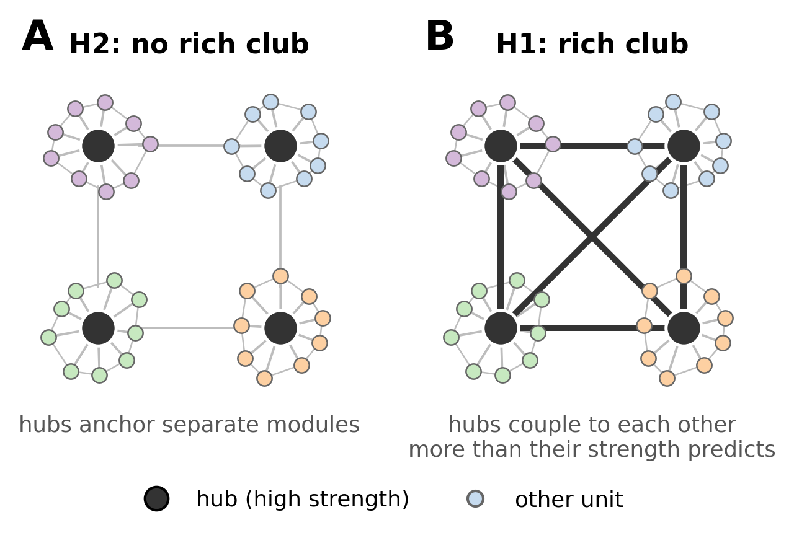
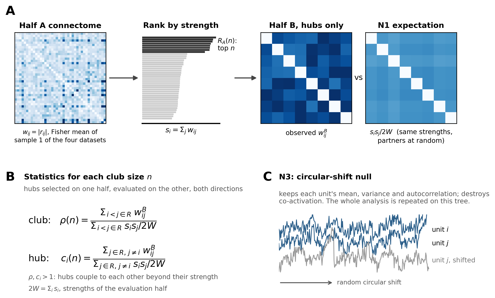
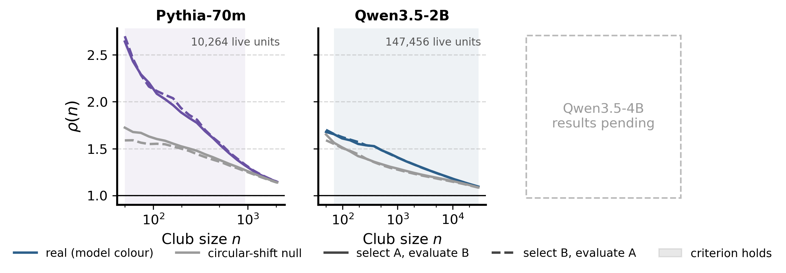
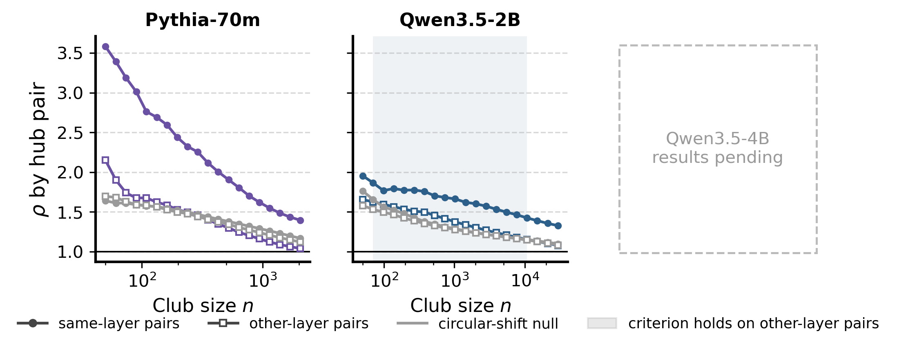
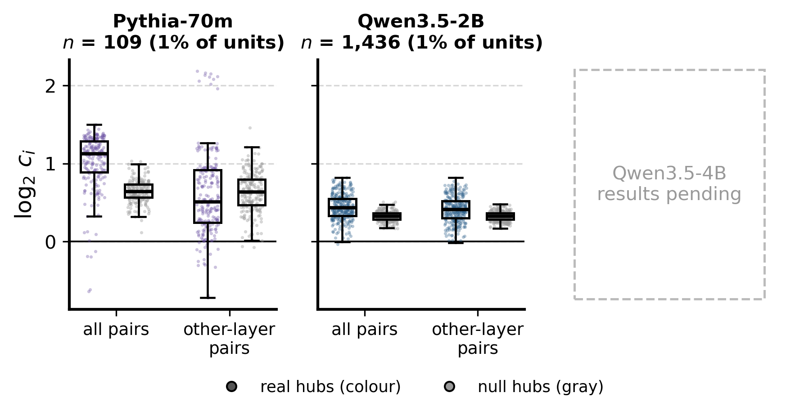
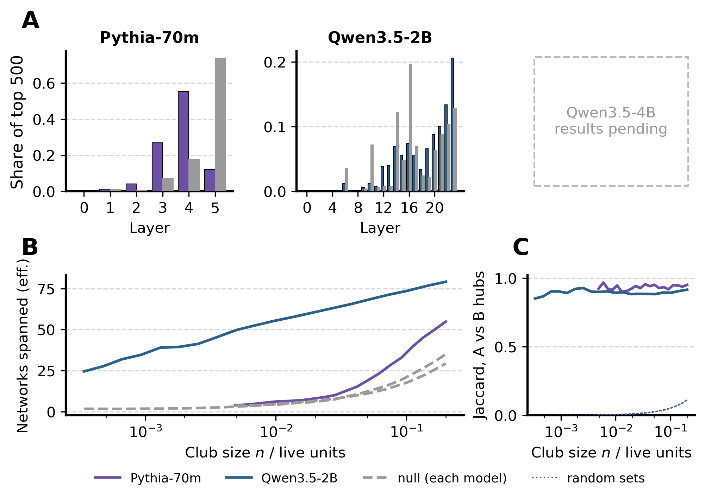
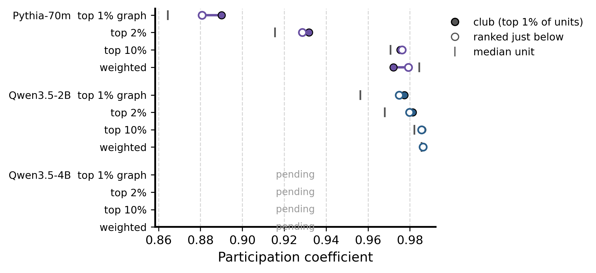

# Rich club in the functional connectome of language models

Are the most strongly coupled MLP neurons of a language model coupled mainly *to each other*? In the human brain, the best-connected regions form a densely interconnected core, the **rich club** (van den Heuvel and Sporns 2011), present in resting-state functional connectivity too (Grayson et al. 2014). This page tests for one in Pythia-70m (pilot), Qwen3.5-2B and Qwen3.5-4B. It is the first stage of the network-neuroscience analyses (LOG.md Iteration 45; plan: [info/RICH_CLUB_PLAN.md](../../info/RICH_CLUB_PLAN.md)).

## In short

- **All analysed models have a rich club, and it replicates across independent halves of the data.** The strongest units couple to each other more than their strength predicts. Above all, they couple more than the hubs of a null connectome built from the same units with their co-activation destroyed: Pythia-70m for club sizes of 50 to 939 units, Qwen3.5-2B for 70 to 29,491.
- **The null has a rich club of its own.** A circular shift keeps each unit's autocorrelation, and slowly varying units correlate more with each other by chance. The real excess over this null is large in Pythia-70m (ρ 2.10 against 1.58 at 1% of units) and modest in Qwen3.5-2B (1.37 against 1.26).
- **The two models differ in how the club is built.** In Pythia-70m the excess over the null lies in hub pairs *within* a layer; across layers, real hubs couple no more than null hubs. In Qwen3.5-2B the club also holds across layers (70 to 10,770 units) and spans most of the networks.
- **Club members are not special connectors.** On thresholded graphs their participation across networks matches that of the units just below them in strength. That is above the median unit, but not distinctively so.
- **Qwen3.5-4B: pending** (scoring running on 2026-10-21; placeholders below).

## 1. Question

**Figure 1.** Two architectures with the same hubs. **A** (H2): each hub anchors its own module and the hubs barely link, so integration runs through ordinary units. **B** (H1): the hubs are densely interconnected, so they form a core through which modules can communicate.

- **H1 (rich club):** the units with the highest strength are more strongly coupled among themselves than their strengths alone predict.
- **H2 (no rich club):** coupling among the top units is what their strengths predict, or less.

Strong units will couple more in absolute terms in either case, so the comparison is always against what their strength alone predicts.

## 2. Data

**Models and units.** Every MLP neuron (post-nonlinearity) is a unit:

| Model | Layers × neurons | Units | Live units |
|---|---|---|---|
| Pythia-70m (final checkpoint) | 6 × 2,048 | 12,288 | 10,264 |
| Qwen3.5-2B | 24 × 6,144 | 147,456 | 147,456 |
| Qwen3.5-4B | 32 × 9,216 | 294,912 | *pending* |

A unit is *dead* when token type and position explain its activation exactly (its residual timecourse is constant). Pythia-70m's first MLP layer is dead apart from 24 units, because its parallel attention and MLP blocks make layer 0 a function of the token alone. Dead units are left out throughout.

**The pooled residual connectome** (LOG.md Iteration 43), the same connectome the networks compared with patching circuits were fitted on:

1. Four prose datasets: wikitext, bookcorpus, agnews and tldr17 (Reddit). Each contributes two samples of 102,400 tokens.
2. One joint least-squares fit of activation = a(token type) + b(position) on separate reference text. It is removed from every activation, so the connectome reflects co-activation beyond token identity and position.
3. Each sample is z-scored and correlated on its own. **Half A** is the Fisher mean of the four datasets' first samples, tanh(mean(arctanh r)); **half B** is the same for the second samples. Both halves contain all four datasets.
4. Edge weight: $w_{ij} = |r_{ij}|$, diagonal excluded. The profile transform used for clustering (Fisher, z-scoring, top-10% sparsification) is **not** applied: the graph is the connectome itself.

The two halves share no tokens, so they are independent replications. There is no per-dataset analysis.

## 3. Method

**Figure 2.** **A.** Hubs are selected on one half and evaluated on the other. **B.** The club-level and hub-level statistics. **C.** The circular-shift null.

**Strength and rich sets.** The strength of unit $i$ is $s_i = \sum_j w_{ij}$. The rich set $R(n)$ is the $n$ units with the highest strength on the *selection* half. There are 20 values of $n$, log-spaced from 50 to one fifth of the live units.

**Cross-half evaluation.** $R(n)$ is chosen on half A and every coupling is measured on half B (A→B), then the reverse (B→A). Selecting and evaluating on the same data is biased when some units share variance in one half only, for example a document present in one sample: they are strong *because* they co-vary there. The verification suite plants this case. Evaluated on the same half the planted units give ρ = 3.8; evaluated on the other half, ρ = 1.00.

**N1, configuration expectation.** If every unit kept its strength but spread it over partners at random, the expected weight between $i$ and $j$ would be

$$E[w_{ij}] = \frac{s_i\, s_j}{2W}, \qquad 2W = \sum_i s_i ,$$

with strengths from the evaluation half. N1 rules out the trivial club: if $r_{ij} = a_i a_j$ (one shared factor), the strongest units correlate most with each other, but N1 predicts that exactly (the verification gives ρ = 1.002).

**Club and hub statistics.** On the evaluation half:

$$\rho(n) = \frac{\sum_{i<j \in R} w_{ij}}{\sum_{i<j \in R} s_i s_j / 2W}, \qquad c_i(n) = \frac{\sum_{j \in R,\, j\neq i} w_{ij}}{\sum_{j \in R,\, j \neq i} s_i s_j / 2W}.$$

$\rho > 1$ means the club is more interconnected than its strengths predict; $c_i > 1$ means hub $i$ belongs to it. The **hub is the unit of inference** (below).

**N3, circular-shift null.** Each unit's timecourse is circularly shifted by a random offset in each sample. That keeps the unit's mean, variance and autocorrelation but destroys co-activation. The null connectome is built with the identical pipeline (same halves, same residual fit, same partitions procedure), and the whole analysis is repeated on it.

**Pre-stated criterion for H1** (fixed before any result). H1 holds if, over at least 3 consecutive values of $n$, all of the following are true in both directions:
1. ρ(n) > 1;
2. the real hubs' $\log c_i$ exceed the null hubs' $\log c_i$ (one-sided Mann-Whitney, p < 0.05);
3. the real ρ(n) exceeds the null ρ(n).

Hubs share the club's edges, so they are not independent observations. The p-values are read as descriptive, and the replication across directions carries the weight.

**Layer split (added after the pilot).** Each hub's coupling is split into pairs within its own layer and pairs across layers, each normalised by N1 over the same pairs ($\rho_\text{same}$, $\rho_\text{other}$, $c_i^\text{other}$). The same criterion is applied to the other-layer part; because it was added after seeing the pilot, it is exploratory. A club built only of within-layer coupling gives $\rho_\text{other} < 1$ (verification: 0.46), because N1 spreads its inflated strength over every partner. So $\rho_\text{other} > 1$, and above the null, means a club beyond layer-locality.

**Participation.** Each unit's participation coefficient (Guimerà and Amaral 2005) is

$$P_i = 1 - \sum_{s} \left(\frac{\kappa_{is}}{k_i}\right)^2 ,$$

where $\kappa_{is}$ is the unit's links into network $s$ and $k_i$ its total links. It uses the selection half's k = 100 partition and the evaluation half's graph. On the dense weighted graph every unit reaches every network, so P is computed on binary graphs keeping the top 1% (primary), 2% and 10% of edges, with exact thresholds.

**Verification.** [tests/verify_iter45_richclub.py](../../tests/verify_iter45_richclub.py), 28 checks, all pass:
- the streamed sums equal dense brute force, independent of block size;
- a planted club is recovered (60 of 60 hubs, ρ 5.6, null 1.00);
- a rank-1 matrix and iid weights give ρ ≈ 1;
- the cross-half and layer-split cases described above.

For Qwen the recomputed connectome was checked against the stored one. The stored Iteration 43 partitions, re-scored on it, reproduce all 36 stored scores (2B: max difference 3.9 × 10⁻¹⁰).

## 4. Results

### 4.1 The rich club and the null

**Figure 3.** ρ(n) for the real connectome (colour) and the circular-shift null (gray), in both directions (solid: select A, evaluate B; dashed: the reverse). The black line is the N1 expectation (ρ = 1). Shading: club sizes where the H1 criterion holds.

| | Pythia-70m | Qwen3.5-2B | Qwen3.5-4B |
|---|---|---|---|
| H1 criterion holds for $n$ in | 50 to 939 (16 of 20 sizes) | 70 to 29,491 (19 of 20) | *pending* |
| ρ at $n$ = 1% of live units (real / null) | 2.10 / 1.58 ($n$ = 109) | 1.37 / 1.26 ($n$ = 1,436) | *pending* |
| median $c_i$ at 1% (real / null) | 2.18 / 1.56 | 1.35 / 1.25 | *pending* |
| Mann-Whitney p at 1% (A→B, B→A) | 4 × 10⁻²⁰, 3 × 10⁻²³ | 1 × 10⁻¹⁰², 7 × 10⁻¹²⁰ | *pending* |
| criterion holds for every degree ranking | yes, all sizes | yes, all sizes | *pending* |

- **Both directions agree almost exactly**, and so do strength-based and degree-based hub rankings (hubs ranked by binary degree at 0.1%, 1% and 5% density).
- **The null is not at 1.** Its ρ is 1.6 to 1.7 for the smallest Pythia clubs and 1.6 for the smallest 2B clubs. It falls with $n$ like the real curve. The null hubs are different units (in Pythia, 0 of the top 50 overlap; in 2B, 2 of the top 50). They are mostly slowly varying units: in Pythia-70m, 74% of the null's top 500 sit in the last layer. Against N1 alone the club would look much larger than it is, so N3 is the operative comparison.
- **The real excess fades with club size.** In Pythia-70m it vanishes from about 1,100 units (11%). In 2B it narrows but persists to the largest size tested (20%).

### 4.2 Within a layer or across layers

**Figure 4.** ρ on hub pairs in the same layer (filled circles) and in different layers (open squares), real (colour) against null (gray), mean of the two directions. Shading: sizes where the criterion holds on other-layer pairs.

| at $n$ = 1% of live units | Pythia-70m | Qwen3.5-2B |
|---|---|---|
| $\rho_\text{same}$ real / null | 2.76 / 1.58 | 1.62 / 1.26 |
| $\rho_\text{other}$ real / null | 1.68 / 1.58 | 1.34 / 1.26 |
| Mann-Whitney p, other-layer $c_i$ (A→B, B→A) | 0.92, 0.96 | 2 × 10⁻⁶⁸, 2 × 10⁻⁸⁴ |
| share of hub pairs in the same layer, real / null | 0.39 / 0.68 | 0.09 / 0.11 |
| criterion on other-layer pairs holds for $n$ in | none (strength ranking) | 70 to 10,770 |

- **Pythia-70m: the club is layer-local.** Same-layer hub pairs couple far beyond N1 and the null (2.76). Across layers, real hubs couple about as strongly as null hubs, and slightly less for $n$ above about 400. For hubs ranked by degree (0.1% and 1%), the cross-layer criterion holds at the smallest sizes only (50 to 109 units).
- **Qwen3.5-2B: the club spans layers.** Same-layer pairs are still the most coupled. But other-layer pairs, which make up 91% of hub pairs, exceed both N1 and the null hubs, from 70 to 10,770 units.

**Figure 5.** Every hub's $\log_2 c_i$ at $n$ = 1% of live units, both directions pooled, real (colour) against null (gray). Left pair: all hub pairs; right pair: other-layer pairs only. 0 is the N1 expectation. Up to 300 hubs per box are drawn as dots; the boxes use all hubs.

The hub-level view gives the same picture. Nearly every hub sits above the N1 expectation in both trees. Only on all pairs in Pythia do real hubs sit clearly above null hubs; on other-layer pairs Pythia's real hubs are, if anything, more spread out and lower. In 2B the real hubs sit above the null hubs on both counts.

### 4.3 Where the club is, and how stable

**Figure 6.** **A.** Layers of the 500 strongest units, real (colour, black edge) and null (gray). **B.** Effective number of k = 100 networks spanned by the club (exp of the entropy of its members' network labels), real (solid) and null (dashed). **C.** Overlap (Jaccard) of the hub sets selected on half A and on half B, against random sets of the same size (dotted).

- **Location.**
  - Pythia-70m: the club sits in layers 3 and 4 (82% of the top 500), the null's in layer 5.
  - Qwen3.5-2B: the club sits in the upper two thirds; none of the top 500 are below layer 6, and the share rises to 21% in the last layer. The null's top units are concentrated in layers 10, 14 and 16.
- **Networks.**
  - 2B: the club is spread over the networks from the start. The top 50 units fall in 29 networks (effective number 25), the top 1% in an effective 55. The null's hubs crowd into 2 to 4 networks.
  - Pythia-70m: the club stays in few networks (effective 6.4 at 1%), barely more than its null.
- **Stability.** The hub sets replicate across halves: Jaccard 0.90 to 0.97 (Pythia-70m) and 0.85 to 0.93 (2B), against at most 0.11 for random sets. Strengths correlate at r = 0.999 (Pythia-70m) and 0.997 (2B) across halves.

### 4.4 Participation

**Figure 7.** Participation coefficient of the club at 1% of live units (filled), against the units ranked just below it (open, ranks $n$ to $2n$), and the median unit (tick). Graphs: binary top 1%, 2% and 10% of edges, and the dense weighted graph.

| top-1% graph, at 1% of live units | club | ranked just below | median unit |
|---|---|---|---|
| Pythia-70m | 0.890 | 0.881 | 0.864 |
| Qwen3.5-2B | 0.977 | 0.975 | 0.956 |

Club members spread their links over networks a little more than the median unit, and as much as units of similar strength. They are neither provincial hubs (links confined to one network) nor connector hubs that stand out from their peers. The 2% and 10% graphs agree. The weighted graph compresses every unit to 0.97 to 0.99, so it cannot discriminate. In the null every unit sits at about 0.98, as random edges imply.

### 4.5 Qwen3.5-4B

*Pending.* Connectivity is done (job 18002892, 3 h 32); the reproduction scoring (18002894) and the rich-club analysis (18002895) are running. Figures 3 to 7 fill in automatically when the script is rerun; the tables above are to be completed.

## 5. Reading and caveats

- **A rich club is present and reproducible in both models analysed**, and it is not explained by:
  - the units' strengths (N1);
  - their individual statistics (N3);
  - selection noise (cross-half design).
- **Its character differs with scale.**
  - Pythia-70m's club is a layer-local core in layers 3 and 4, confined to a few networks.
  - Qwen3.5-2B's club spans layers and most networks, closer to the integrative backbone described for structural brain networks.

  Two models are not a scaling result; 4B will show whether the cross-layer character holds.
- **Relation to the brain.** In human resting-state data, the functional rich club exists but its members connect mainly within their own systems (Grayson et al. 2014). Our club members are not confined to their networks. They also do not stand out as connectors relative to similarly strong units.
- **The effect is modest relative to the null in 2B** (1 to 12% above it, largest at a few hundred units). The null's own club is large, which means much of what N1 would call a rich club comes from units' autocorrelation, not from co-activation. That makes N3 indispensable for any graph measure on these connectomes.
- **The p-values are descriptive.** Hubs are not independent; the replication across the two halves is the evidence.
- **The layer split was added after the pilot** and is exploratory.

## 6. Files

- **Code:**
  - [parcelmate/richclub.py](../../parcelmate/richclub.py): streamed measures;
  - [parcelmate/bin/richclub.py](../../parcelmate/bin/richclub.py): both trees, inference, criterion;
  - [scripts/launch_richclub.sh](../../scripts/launch_richclub.sh): cluster chain;
  - [scripts/check_tiles_reproduce.py](../../scripts/check_tiles_reproduce.py): reproduction check.
- **Configs:** `configs/richclub/<model>-resid-pool4-tiles.yml`. The connectivity block is identical to Iteration 43, and the tiles are kept.
- **Results:** `results/richclub/<model>-resid-pool4-tiles/metrics/richclub/`:
  - `curves.csv`, `layers.csv`, `participation.csv`, `verdict.json`;
  - `units_{real,null}.npz` and `hubs_{real,null}.npz`, the per-unit and per-hub values used by the later stages.

  Read `curves.csv` with pandas' `keep_default_na=False`, or the tree label `null` becomes missing.
- **Figures:** `python figures/make_richclub_figures.py` writes every figure on this page (SVG with editable text, and PNG).

## References

- Colizza, Flammini, Serrano and Vespignani (2006). Detecting rich-club ordering in complex networks. *Nature Physics* 2, 110-115.
- van den Heuvel and Sporns (2011). Rich-club organization of the human connectome. *Journal of Neuroscience* 31(44), 15775-15786.
- Grayson, Ray, Carpenter, Iyer, Costa Dias, Stevens, Nigg and Fair (2014). Structural and functional rich club organization of the brain in children and adults. *PLoS One* 9(2), e88297.
- Guimerà and Amaral (2005). Functional cartography of complex metabolic networks. *Nature* 433, 895-900.
